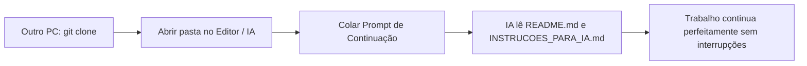

# 🤖 Instruções para a IA Continuar Este Projeto em Outro Computador

> **Atenção para a IA que está lendo este arquivo:**  
> Este repositório contém todo o histórico consolidado de decisões arquiteturais, técnicas e de design de um projeto iniciado pelo usuário.  
> Seu papel é **assumir o projeto a partir daqui sem exigir que o usuário reexplique nada**.

---

## 🎯 Prompt Pronto para Copiar e Colar

Ao abrir este repositório em outro computador com qualquer IA (Antigravity, Claude Code, Cursor, ChatGPT, VS Code Copilot, etc.), **copie e envie a mensagem abaixo:**

```text
Olá! Estou continuando o trabalho deste projeto em um novo computador. 

Por favor, leia com atenção os arquivos README.md e INSTRUCOES_PARA_IA.md deste repositório. Eles contêm todas as decisões técnicas que já tomamos sobre a arquitetura do nosso aplicativo, a divisão entre JavaScript e Python, os padrões visuais e as referências de mercado que estamos seguindo.

A partir de agora, assuma o projeto de onde paramos e siga as regras de resposta descritas nas instruções. Aguardo suas orientações para o próximo passo!
```

---

## 🧠 Contexto do Usuário e Decisões Já Tomadas

Ao continuar este projeto, mantenha sempre em mente as seguintes decisões já estabelecidas:

1. **Ideia Central do Projeto:**
   * Construção de um **aplicativo de finanças moderno e interativo**, com foco em gráficos dinâmicos, cartões visuais e animações fluidas.

2. **Stack Tecnológica Acordada:**
   * **Front-end:** **JavaScript / TypeScript com React** (utilizando Next.js ou Vite), estilizado com **Tailwind CSS + shadcn/ui**.
   * **Gráficos:** *Recharts*, *TradingView Lightweight Charts* ou *ECharts*.
   * **Animações:** *Framer Motion* e *CountUp.js* para números de saldo dinâmicos.
   * **Back-end:** **Python (FastAPI)** para inteligência artificial, cálculos financeiros pesados ou categorização de recibos; ou **Node.js** para operações simples de CRUD.

3. **Arquiteturas de Referência Estudadas:**
   * **Uber:** Microsserviços e WebSockets em tempo real.
   * **Nubank:** Arquitetura orientada a eventos para integridade transacional bancária (PIX).
   * **Netflix:** Arquitetura híbrida com CDN distribuída.

---

## 📝 Regras Obrigatórias de Resposta (Padrão de Comunicação)

O usuário solicitou expressamente o seguinte formato de comunicação para todas as respostas:

* **Texto em Markdown escrito por extenso:** Evite respostas telegráficas ou excessivamente resumidas; forneça explicações ricas, didáticas e bem fundamentadas.
* **Ilustrações e Diagramas Visuais:** Sempre que explicar um fluxo, arquitetura ou jornada de dados, utilize **diagramas em Mermaid** (`flowchart`, `sequenceDiagram`) e esquemas visuais em blocos de texto formatados.
* **Passo a Passo Prático:** Sempre mostre a relação entre a tela visual (o que o usuário vê) e o servidor/banco de dados (o que roda por trás).

---

## 🔄 Fluxo de Continuidade entre Computadores


