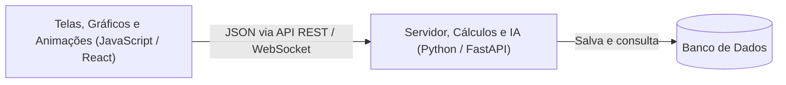
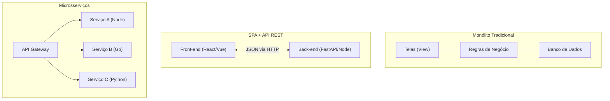
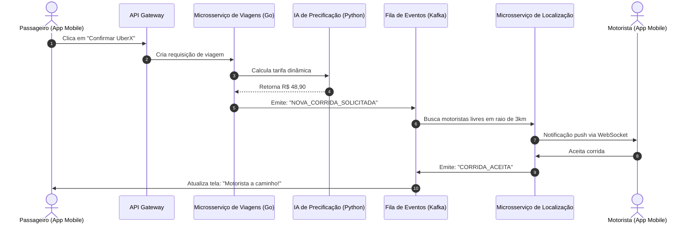
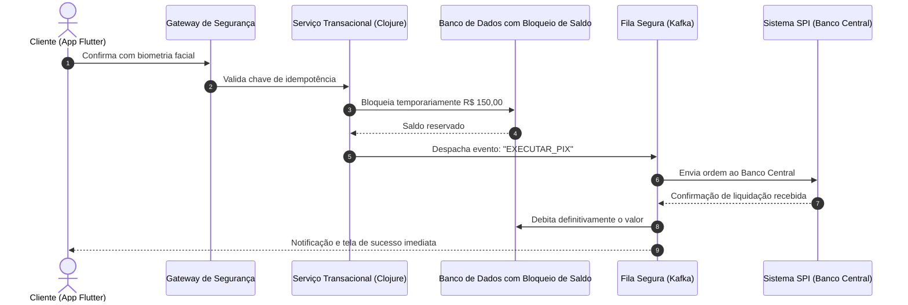

# 📚 Guia Definitivo: Linguagens de Programação, Arquitetura de Software e Inteligência Artificial

> Este documento reúne todo o conteúdo detalhado, com ilustrações, diagramas de arquitetura passo a passo e conceitos fundamentais discutidos sobre ecossistemas de software modernos, inteligência artificial e os padrões utilizados pelas maiores empresas de tecnologia do mundo.

> [!TIP]
> **Vai continuar este projeto em outro computador com outra IA?**  
> Consulte o arquivo com o prompt e as regras prontas em: **[INSTRUCOES_PARA_IA.md](INSTRUCOES_PARA_IA.md)**.

---

## 📑 Índice
1. [Linguagens Padrão das IAs (Antigravity, Codex, Claude)](#1-linguagens-padrão-das-ias)
2. [Para que serve o Python?](#2-para-que-serve-o-python)
3. [Para que serve o JavaScript?](#3-para-que-serve-o-javascript)
4. [Construção de Aplicativos Interativos e Financeiros](#4-construção-de-aplicativos-interativos-e-financeiros)
5. [Integração do JavaScript com o Microsoft Visual Studio](#5-integração-do-javascript-com-o-visual-studio)
6. [Python + JavaScript: Quando usar a dupla ou apenas um deles?](#6-python--javascript-quando-usar-a-dupla)
7. [Por que as IAs começam criando em Python e não em JavaScript?](#7-por-que-as-ias-começam-criando-em-python)
8. [Os Aplicativos Mais Famosos do Mundo e suas Linguagens](#8-os-aplicativos-mais-famosos-do-mundo)
9. [O Ecossistema da Adobe (C++, WebAssembly e Plugins)](#9-o-ecossistema-da-adobe)
10. [As Principais Arquiteturas de Software](#10-as-principais-arquiteturas-de-software)
11. [Estudos de Caso Reais: Telas e Fluxos Arquiteturais Passo a Passo](#11-estudos-de-caso-reais)
    - [Caso 1: Uber (Microsserviços em Tempo Real)](#caso-1-uber)
    - [Caso 2: Nubank (Orientada a Eventos e Consistência PIX)](#caso-2-nubank)
    - [Caso 3: Netflix (Híbrida e CDN Distribuída)](#caso-3-netflix)
12. [Como Diferentes Linguagens se Comunicam Entre Si](#12-como-diferentes-linguagens-se-comunicam)

---

## 1. Linguagens Padrão das IAs

No ecossistema de inteligência artificial atual, existem dois papéis principais: a linguagem que o ecossistema usa por baixo dos panos e a linguagem que os assistentes de código priorizam no dia a dia.

### A Linguagem Universal da IA: Python
* **Treinamento e Pesquisa:** Praticamente todos os modelos modernos são criados usando frameworks em Python (*PyTorch*, *JAX*, *TensorFlow*), com núcleos de alta performance compilados em **C++ / CUDA**.
* **Benchmarks e Avaliações:** Os principais testes de raciocínio de código da indústria (como o *HumanEval*) foram criados originalmente em Python.
* **Ecossistema de Agentes:** Bibliotecas de agentes, automação, manipulação de dados e APIs de LLMs sempre têm suporte primário em Python.

### Plataformas Específicas:
* **Antigravity (Google DeepMind):** Utiliza **Python** no SDK de agentes, automações de workflows e análise de dados, e **TypeScript** para ferramentas de extensibilidade e plugins.
* **Codex (OpenAI):** Foi treinado com ênfase massiva em repositórios abertos de **Python** (a base do benchmark HumanEval e dos primeiros Copilots), embora seja multilíngue.
* **Claude (Anthropic):** Utiliza **Python** para análise de dados e execução de código em sandbox (REPL/Artifacts) e **TypeScript** na construção da sua ferramenta de linha de comando oficial (*Claude Code*).

---

## 2. Para que serve o Python?

Python é uma linguagem de uso geral com sintaxe limpa e muito próxima do inglês. Suas áreas de maior destaque:
1. **Inteligência Artificial e Ciência de Dados:** Criação de redes neurais, machine learning, agentes autônomos e tratamento de dados com *Pandas*, *NumPy*, *PyTorch* e *TensorFlow*.
2. **Automação de Tarefas e Scripts:** Robôs de automação, web scraping (*BeautifulSoup*, *Playwright*), conversão de arquivos e integração de planilhas.
3. **Desenvolvimento Web e APIs (Back-end):** Construção de servidores rápidos e modernos com *FastAPI*, *Django* e *Flask*.
4. **Cibersegurança e Redes:** Criação de ferramentas de auditoria e testes de intrusão (*pentesting*).
5. **Finanças Quantitativas e Engenharia:** Algoritmos de precificação, simulações matemáticas e cálculos estatísticos.

---

## 3. Para que serve o JavaScript?

O JavaScript é a linguagem que faz a **internet ter vida e interatividade**. Ele permite programar desde a interface do navegador até servidores e aplicativos de celular:
1. **Interatividade na Web (Front-end):** Abrir menus, animar elementos, enviar dados sem recarregar a página e gerenciar interfaces completas com *React*, *Next.js* e *Vue*.
2. **Servidores e APIs (Back-end):** Através do *Node.js*, *Bun* e *Deno*, cria servidores rápidos e sistemas com conexões em tempo real.
3. **Aplicativos de Celular (Mobile):** Com o *React Native*, gera apps nativos para Android e iOS (usado por Instagram, Discord, Uber Eats).
4. **Aplicativos de Computador (Desktop):** Com o *Electron*, cria softwares instaláveis no Windows, Mac e Linux (como VS Code, Discord, Spotify e Slack).
5. **O papel do TypeScript:** Uma evolução criada pela Microsoft que adiciona tipagem estática e segurança ao JavaScript, sendo o padrão adotado em projetos corporativos.

---

## 4. Construção de Aplicativos Interativos e Financeiros

Para criar um aplicativo de finanças moderno com gráficos e animações:
* **Base da Interface:** *React* ou *Next.js* / *Vite*.
* **Gráficos Financeiros:**
  * *Recharts* ou *Chart.js*: Para despesas em pizza, barras e fluxo de caixa.
  * *Lightweight Charts (TradingView)*: Para gráficos de ações e cripto (*candlesticks*) em tempo real.
  * *Tremor* / *ECharts*: Para painéis e dashboards executivos.
* **Animações Fluidas:**
  * *Framer Motion*: Transições de tela, cards arrastáveis e micro-interações.
  * *CountUp.js*: Animação de números de saldo subindo gradualmente.
* **Design System:** *shadcn/ui* + *Tailwind CSS* para estética moderna e profissional.

---

## 5. Integração do JavaScript com o Visual Studio

A Microsoft é uma das principais mantenedoras do ecossistema JavaScript/TypeScript mundial:
* **Visual Studio Code (VS Code):** É construído nativamente em **JavaScript e TypeScript** (via Electron). O suporte é de primeiro nível, incluindo IntelliSense, depurador de código com breakpoints integrados no navegador e desenvolvimento de extensões em TypeScript.
* **Visual Studio tradicional (IDE completo):** Possui suporte oficial a Node.js, TypeScript e React, ideal para projetos corporativos integrados a C# e .NET.
* **Contribuições da Microsoft:** Criadora do **TypeScript**, proprietária do **npm** e do **GitHub**.

---

## 6. Python + JavaScript: Quando usar a dupla?



* **Usar a Dupla (Python + JavaScript):** Quando o sistema precisa de uma interface rica e interativa comunicando com modelos de inteligência artificial, cálculos financeiros complexos ou análise massiva de dados.
* **Usar Apenas JavaScript (Full-Stack):** Quando o objetivo é agilidade e um sistema padrão (cadastro, e-commerce, finanças pessoais simples). Uma única linguagem no front-end e no back-end (*Node.js*).
* **Usar Apenas Python:** Para ferramentas de linha de comando, automação de escritório ou protótipos com telas simples geradas via *Streamlit*.

---

## 7. Por que as IAs começam criando em Python?

Quando um usuário pede para um assistente criar um programa genérico, a IA costuma optar por Python por quatro motivos:
1. **Zero Atrito de Configuração:** Um script em Python precisa de apenas um arquivo (`app.py`) e roda imediatamente com `python app.py`. Em JavaScript, geralmente é necessário criar `package.json`, instalar `node_modules`, configurar módulos (ES Modules vs CommonJS) e bundlers.
2. **"Pilhas Inclusas" (*Batteries Included*):** Python já vem de fábrica com banco de dados embutido (`sqlite3`), leitor de CSV/JSON e bibliotecas matemáticas nativas.
3. **Ambiente de Terminal:** Assistentes como Claude Code e Antigravity rodam no terminal. Python roda diretamente no terminal, enquanto a força do JavaScript aparece ao renderizar no navegador web via portas locais (`localhost:3000`).
4. **Como contornar:** Basta pedir expressamente: *"Crie uma aplicação web em React / JavaScript para..."*.

---

## 8. Os Aplicativos Mais Famosos do Mundo

Grandes plataformas mundiais dividem suas responsabilidades entre várias linguagens:

| Aplicativo | Telas / Front-end | Servidores / Back-end | Motores de IA e Performance |
| :--- | :--- | :--- | :--- |
| **Instagram** | React Native (JS/TS), Swift, Kotlin | **Python (Django)** | C++ (processamento de fotos) |
| **Spotify** | JS/TS (Electron), Swift, Kotlin | Java, C++ | **Python** (algoritmos de recomendação musical) |
| **Netflix** | **React (JS/TS)** em TVs e Web | Java, Node.js | **Python** (Machine Learning de capas e séries) + C (CDN) |
| **WhatsApp** | Swift (iOS), Kotlin (Android), React (Web) | **Erlang** (mensageria para bilhões de usuários) | C++ |
| **TikTok** | C++, Swift, Kotlin | **Go (Golang)** | **Python / C++** (algoritmo de recomendação) |
| **Uber** | Swift, Kotlin | **Go, Java** (rotas e geolocalização) | **Python** (precificação dinâmica) |
| **ChatGPT** | **Next.js / React (JS/TS)** | **Python (FastAPI)** | **Python (PyTorch) + C++/CUDA** (inferência nos chips) |
| **Discord** | **React + Electron (JS/TS)** | Elixir, **Rust** | Rust (áudio e alta velocidade de processamento) |
| **Nubank** | **Flutter (Dart)** | **Clojure** | Clojure (programação funcional voltada para integridade bancária) |

---

## 9. O Ecossistema da Adobe

A Adobe foca em computação gráfica de altíssimo rendimento:
* **O Núcleo dos Programas (Photoshop, Premiere, Illustrator):** Escrito em **C++** para manipulação direta de pixels na memória e comunicação com placas de vídeo via DirectX, Metal e CUDA.
* **Automação e Criação de Plugins:** Utiliza **JavaScript / TypeScript** através do *Adobe UXP* (Unified Extensibility Platform).
* **Photoshop Web:** Compilou os milhões de linhas de código original em **C++** para **WebAssembly (Wasm)**, rodando dentro do navegador com interface em **JavaScript/TypeScript**.
* **Inteligência Artificial (Adobe Firefly):** Pesquisa e modelos em **Python (PyTorch)** com inferência rápida em **C++/CUDA**.

---

## 10. As Principais Arquiteturas de Software



* **Monólito Tradicional (MVC):** Toda a aplicação (telas, regras e banco) roda em um único pacote e servidor. Excelente para MVPs e equipes pequenas.
* **SPA (Single Page Application):** Front-end separado em JavaScript que carrega uma vez só e consome dados leves em JSON de uma API. Altíssima fluidez visual.
* **SSR / Híbrida (Server-Side Rendering):** Pré-renderiza a página no servidor para garantir carregamento instantâneo e ótimo ranqueamento no Google (SEO), ativando a interatividade com JavaScript em seguida (*Next.js, Nuxt*).
* **Microsserviços:** Divide um sistema gigante em dezenas de pequenos programas independentes que conversam por uma porta central (*API Gateway*). Adotado por Netflix, Uber e grandes bancos.
* **Serverless (FaaS):** Funções isoladas que rodam sob demanda na nuvem (*AWS Lambda, Google Cloud Functions*) e desligam após a execução, gerando custo zero enquanto ociosas.
* **Arquitetura Orientada a Eventos:** Serviços que se comunicam através de filas de mensagens (*Apache Kafka, RabbitMQ*), garantindo que nenhuma transação seja perdida.
* **Clean Architecture (Arquitetura Limpa):** Padrão de organização interna de código onde as regras de negócio nunca dependem de bancos de dados ou telas, facilitando manutenções e testes.

---

## 11. Estudos de Caso Reais

### Caso 1: Uber
**Arquitetura:** Microsserviços + Barramento de Eventos em Tempo Real (Kafka + WebSockets).

```text
┌──────────────────────────────────────────────┐
│  UBER                              14:30  5G │
├──────────────────────────────────────────────┤
│  [ Mapa em Tempo Real com Carros em Movimento ]
│                                              │
│          ( Ponto de Partida: Av. Paulista )  │
│                 │ (Rota Traçada)             │
│                 ▼                            │
│          ( Destino: Aeroporto de Guarulhos ) │
│                                              │
│  ┌────────────────────────────────────────┐  │
│  │ UberX - R$ 48,90 (Chega em 3 min)      │  │
│  │ [Cartão Nubank final 8921]             │  │
│  └────────────────────────────────────────┘  │
│                                              │
│  [       CONFIRMAR E SOLICITAR UBER       ]  │
└──────────────────────────────────────────────┘
```



---

### Caso 2: Nubank
**Arquitetura:** Orientada a Eventos + CQRS com Garantia de Consistência Transacional.

```text
┌──────────────────────────────────────────────┐
│  NUBANK                            15:10     │
├──────────────────────────────────────────────┤
│  Transferência PIX                           │
│                                              │
│  Valor: R$ 150,00                            │
│  Para: Maria Oliveira (Banco do Brasil)      │
│  Chave: maria.oliveira@email.com             │
│                                              │
│  Saldo disponível: R$ 1.250,00               │
│                                              │
│  ┌────────────────────────────────────────┐  │
│  │ [✓] Autenticação Biométrica / Senha    │  │
│  └────────────────────────────────────────┘  │
│                                              │
│  [          CONFIRMAR TRANSFERÊNCIA       ]  │
└──────────────────────────────────────────────┘
```



---

### Caso 3: Netflix
**Arquitetura:** Híbrida (SSR/SPA) + CDN Distribuída Próxima ao Usuário (Open Connect).

```mermaid
flowchart TD
    subgraph Cliente["Navegador ou Smart TV"]
        Interface["App em React / JavaScript"]
    end
    subgraph Nuvem_AWS["Nuvem Central (AWS)"]
        Gateway["API Gateway"]
        Recomendacao["Motor de IA (Python)"]
    end
    subgraph CDN_Local["Servidores Locais no seu Provedor de Internet (Open Connect)"]
        ServidorProvedor["Computador físico com os filmes em 4K pré-carregados"]
    end

    Interface -->|"1. Solicita Catálogo"| Gateway
    Gateway --> Recomendacao
    Recomendacao -->>|"2. Devolve capas personalizadas em JSON"| Interface
    Interface -->|"3. Clica no Play"| ServidorProvedor
    ServidorProvedor -->|"4. Transmite blocos do vídeo em alta velocidade"| Interface
```

---

## 12. Como Diferentes Linguagens se Comunicam

Linguagens diferentes não precisam entender o código uma da outra para trabalharem juntas:
1. **Pela Internet (APIs REST / JSON):** Uma linguagem empacota os dados em texto padronizado (JSON) e envia via requisição web (HTTP). É como duas pessoas de países diferentes se comunicando em inglês.
2. **Pelo Banco de Dados Compartilhado:** Uma linguagem insere uma linha no banco de dados e outra linguagem lê essa mesma linha momentos depois.
3. **Pela Memória RAM (C-Bindings / FFI):** Quando a velocidade é crítica, o código amigável em Python aperta um gatilho que executa funções de baixo nível pré-compiladas em C/C++ diretamente no chip de memória.

---

*Guia gerado pelo Antigravity (Google DeepMind).*
